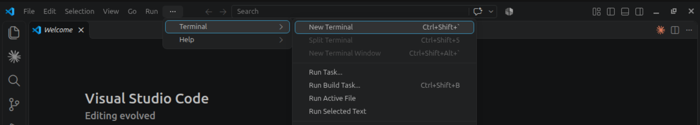

# Prelude: setting up the lab

In this chapter, we will be setting up our lab environment that will be used in the remainder of the book.

You can use many different setups if you prefer, but keep in mind that all practical exercises and challenges will assume that you have installed the following lab with the specific software and OS versions mentioned.

You may find that the instructions differ in the GitHub and the book? It's normal. Cryptography and Networking are fast-changing areas, and many things that workk perfectly one year maybe broken by unforeseen deprecation or depencies the next. Always assume that the most up to date information is found in the GitHub repository.

You do not need an advanced computing, networking, mathematic or programming knowledge to do this setup or to follow the exercises, however, this book will assume that you have at least some familiarity with these areas. If you struggle, I can only suggest researching online or on Youtube for more specific tutorials.

## Part 1 - Setup your workbench

### Step 1 - Register to Github

I am always amazed to meet 4th year university students, here in Napier -where I work- who never created a single repo! How can one work this way?

If you're already familiar with Github and already have an account, skip this and directly clone our repo and move on to the next step.

If not, what is Github? Github is the online, web-based cousin of Git, the second present to the world made by a certain Linus Torvald (if you do not know who that is, look it up!)

It essentially is a web application which allows you to save, update, version and share your work. Each project gets its own *repository* (usually shortened into repo). The really cool thing is that you can then copy this repository onto your laptop (*clone* it), work on it, then upload the changes (*push* it). If anyone else makes changes to it, you can download the changes (*pull* them). This allows you to keep a neat and safe version of your work, available everywhere with just a few command lines!


Head to
[GitHub](https://github.com/signup)
And sign up for a free account!
Remember to use a sensible name for your account, by definition, at some point you might want to share it with others.


*The Github Dashboard*

### Step 2 - Install Visual Studio Code

Now that we have a Github account setup, let's setup our workbench. Microsoft Visual Studio Code (VS Code) is probably the most used and most convenient code editor there is. It has countless extensions in its library, and integrates terminal, github and AI in a single place where you can read, work and save your work in a convenient way.

It is available on all platforms, for free.


Head to
[Visual Studio Code](https://code.visualstudio.com/download)
And download then install VS code.


*Visual Studio Code*

### Step 3 - Install Git

Git is the engine that works behind Github. If your machine does not have it installed yet, follow the instructions to install it

In VScode, open a Terminal (click on the top menu, or use the shortcut )


*Opening a new terminal*


*New Terminal*

Now copy paste the following code to install Git, according to your Operating System:

Windows
```bash
winget install --id Git.Git -e --source winget
```
Mac OS
```bash
xcode-select --install
```
Linux (Debian/Ubuntu)
```bash
sudo apt install git
```

Once installed, verify the installation:

```bash
git --version
```

*Git Installed*

Now, configure it by setting a set name and email, using the same than you've used to set up your GitHub account

```bash
git config --global user.name "Your GitHub username"
git config --global user.email "you@example.com"
```

### Step 4 - Download the Book Repo

Now, head to this course's [repository](https://github.com/gillo7/Book), and download the zip folder containing all the chapters, code and challenges you will need to work through the practical exercises.


*Download the Zip of the repo*

Once downloaded, unzip it, rename it what you want, and place it somewhere sensible (Documents, Desktop, wherever you can find it again!)

Now, head back to VScode, and select File, Open Folder.. and select the repo's folder.

The left handside panel will show you all the contents of the folder, and opening a new terminal now should have it already working in that folder!

This folder is now yours, and you will be able to add notes, fill in your attempts at the practicals and save your own programs, modify or add your own code, upload your cool programs, and record your progress!
And to keep everything safe, we're now going to upload it into your very own repo on your own Github account!

### Step 5 - Uploading your repo

Now, click on the Branching icon on the left hand side of VScode panels


*Publish to Github*

VS Code will prompt your to sign in to GitHub, click Allow and authorise VS Code. The browser will bring you back to VS Code and the publish will carry on. From now on, VS Code will remember that this folder is linked to your GitHub account, and you will be able to push and pull changes directly from the terminal at will!

There are several ways to commit changes to GitHub. But VS Code and GitHub have you covered.. just use the little icon next to the branch main at the bottom left of your screen for a shortcut. And you can do this as many times and as often as you want.

### Step 6 - VS Code, Markdown and adding your notes

What follows are optional tips and tricks of the trade to make your life easier when working on VS Code and using Markdown.

When you open a chapter .md file you can immediately notice that the text seems a bit strange? Normal, VS Code is showing you the code source. But press Control+Shift+V and you will actually see the text as it is meant to be seen! Click Control+Shift+V again if you ever need to add/modify any of the text (and remember to Control+S to save locally or click the icon at the bottom to upload your changes!)

Markdown is a very simple way to write and save text. It is recognisible by the .md file extension, and as you probably noticed, is used for all the textual contents of the repo. Feel free to explore Markdown further, it is a brilliant thing, but essentially to add your notes and complete exercises efficiently, you should just know the following:

Using `#` makes a title, more `#`s make the title smaller, it is usually used to do title/chapter/section/subsections.
Using `*` around text makes it italic, using `**` around text makes it bold.
Using the backtick around text makes it `code`
Using three backticks in between separate lines makes it several lines of code
```python
if 2 > 1:
    print("Hello World!")
else:
    print("two is always bigger than one")
```
and you can substitute bash for python, java, etc depending on which programming language you use. And it'll automatically be possible to copy it, and the colouring scheme will change accordingly. Pretty neat!

And if you want to add your own notes within the course? 
Just use `>` in front of your line and it'll appear in a separate box.

>This is my comment

There are many more options, especially if you include HTML tags, but this will suffice for now.

## Part 2 - Installing and connecting to your Ubuntu VM

### Step 1 - Installing Virtual Box
### Step 2 - Getting the Ubuntu image
### Step 3 - Configuring the VM and the Network
### Step 4 - Installing Ubuntu
### Step 5 - Connecting to the VM via SSH
### Step 6 - Verifying connectivity and updates
### Step 7 - Creating a Python program

